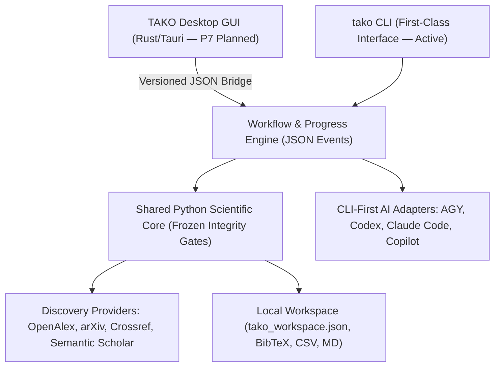
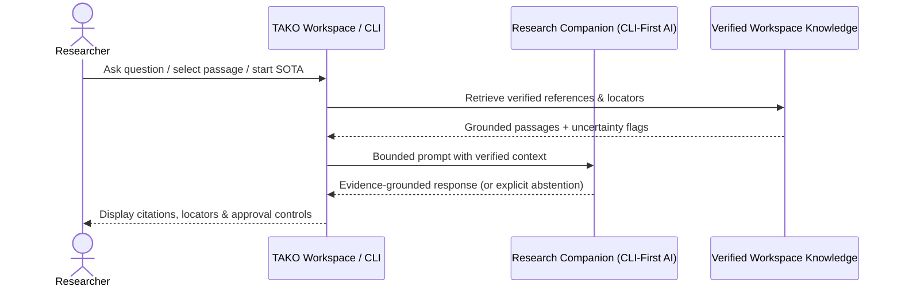
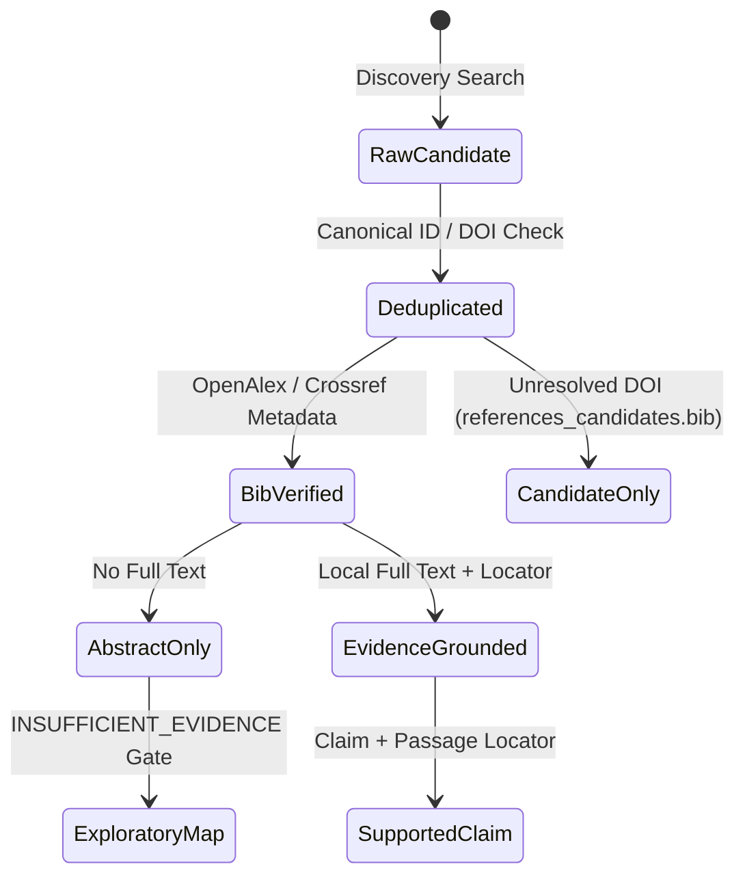

# TAKO ARDE Architecture

TAKO preserves a single shared **Python Scientific Core** (`tools/`) paired with a future **Rust/Tauri Desktop Shell** (`P7`) communicating over explicit versioned JSON contracts. Scientific algorithms and Tier 1 quality gates are never duplicated between CLI and GUI.

## 1. ARDE System Architecture

## 2. AI Provider & Authorization Separation
- **CLI-First AI Targets:** Antigravity CLI (`agy`), Codex CLI (`codex`), Claude Code (`claude`), GitHub Copilot CLI (`copilot`).
- **No Direct LLM API Key Required:** Standard workflows use existing authenticated local CLI sessions (`subscription_cli` mode), never silently invoking nested agents or falling back to paid APIs.
- **Explicit Metered API Separation:** Direct metered LLM APIs (e.g., `OPENAI_API_KEY`) remain strictly gated behind `--allow-paid-api`.

## 3. Research Companion Interaction

## 4. Scientific Knowledge & Evidence Lifecycle

