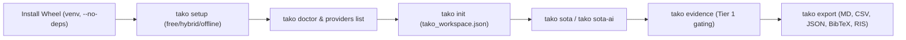
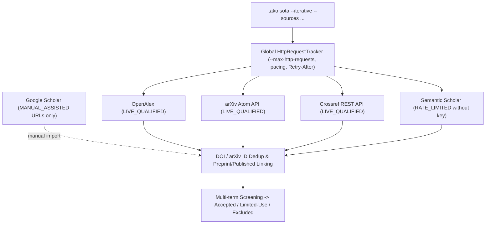
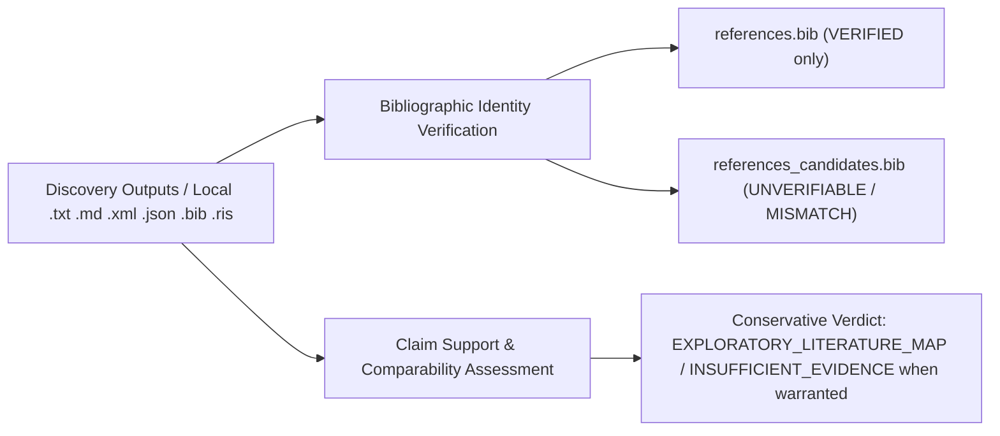
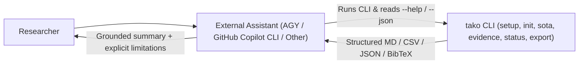
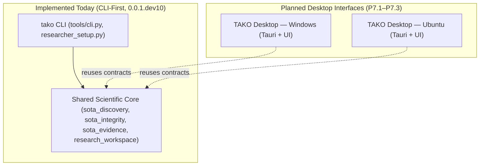
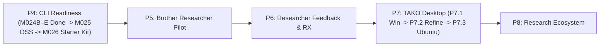

# TAKO ARDE Architecture Diagrams

## 01 — Researcher Workflow

## 02 — Multi-Source Discovery

## 03 — Evidence and Scientific Integrity

## 04 — External AI Assistant Integration

## 05 — Current CLI and Future Desktop Boundary

## 06 — High-Level Product Roadmap

