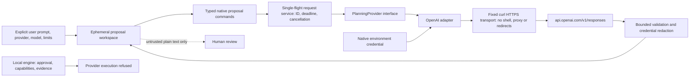

# Proposal-only provider boundary

TAKO-012 implements the TAKO-011 planning proposal in `bridge/src/providers.rs`.
One adapter supports OpenAI Responses over the official HTTPS endpoint. Anthropic,
Gemini and local model identities are reserved; their adapters are unavailable.
There is no agent execution, tool loop or automatic conversion to a scripted plan.

## Architecture and trust

The request service has no Engine, project path, filesystem context walker, shell
command, Git handle, approval object or evidence writer. Adapters are trusted
native application code; their API shape is not an OS sandbox. Model output remains
untrusted text, including claims about outcomes, permissions or confinement.

Text-only mode sends the entered prompt plus provider/model/limits. TAKO-013 also
supports opt-in [project context and scoped session history](PROJECT_AI_CONTEXT.md):
a native workspace constructs and previews a frozen input, then requires explicit
consent before passing that text to this same provider service. The provider
service and adapters receive no filesystem capability. Output is escaped text,
without HTML execution, tool dispatch, plan conversion or file application. History
is ephemeral native session state, never mission evidence. The provider service
retains its most recent job, with one active request per Bridge. The workspace uses independent pending
state, so local project/mission operations remain usable. T is unrelated and may
remain disabled throughout.

## Interface

| Type / operation | Contract |
| --- | --- |
| ProviderFamily | open_ai, anthropic, gemini, local_model; only OpenAI implemented |
| ProposalRequest | provider, explicit model ID, prompt, timeout_s, max_output_tokens; unknown fields rejected |
| PlanningProvider.identity | Adapter identity; must match the selected family |
| PlanningProvider.propose | Explicit request and RequestControl; returns text/usage or structured error |
| RequestControl.check | Enforces cooperative cancellation and deadline; an adapter must check during transport I/O |
| ProposalResponse | provider, provider-reported model, untrusted text, optional token usage, untrusted=true |
| ProposalJob | Native-generated request_id; pending, cancelling, succeeded, failed or cancelled; response/error |
| proposal_start | Validates request, loads native credential on submit, starts one background request |
| proposal_poll | Reads local job metadata only; never makes another model API call |
| proposal_cancel | Cancels the exact active ID; terminal requests remain terminal |

`succeeded` means a complete text response was retrieved and parsed, never mission
execution, verification or acceptance. A model alias may resolve to a provider
snapshot; the response model is labelled provider-reported, not an authenticity
claim. Missing token usage is null; present usage must be nonnegative and internally
consistent. Errors use stable codes and static messages, never raw provider bodies,
transport diagnostics, authorization headers or parse excerpts.

Limits: prompt at most 16384 UTF-8 bytes, model ID at most 128 ASCII identifier
characters, timeout 1–120 seconds (UI default 30), output limit 16–4096 tokens (UI
default 1024), body limit 262144 bytes. No model is preselected or discovered by a
startup request. Invalid settings, missing credentials, unsupported providers,
refusals, incomplete results, tool output and malformed payloads fail closed.

## OpenAI protocol and transport

The adapter sends POST to `https://api.openai.com/v1/responses` with model, input,
max_output_tokens, store=false, stream=false, tools=[] and tool_choice=none. It
accepts completed assistant output_text messages, optionally alongside reasoning
items, and usage. It rejects unsupported output types and incomplete/refused
results. This follows the [official Responses create reference](https://developers.openai.com/api/reference/typescript/resources/responses/methods/create),
consulted for this implementation; live model/account compatibility was not tested.

The runtime dependency is the system `/usr/bin/curl`, using its system TLS trust
store. TAKO-012 needed no Rust/Node dependency or lockfile change. TAKO-013 directly
reuses the already pinned libc dependency for native safe context reads. Curl is launched as a
fixed native transport process, never through a shell or with model-controlled
arguments. Its config arrives over stdin: key and prompt are absent from argv and
child environment. Config quoting is distinct from shell quoting and is qualified
with quotes, escapes, newlines, Unicode and literal command syntax in the prompt.
The serialized request always starts with a JSON object, so curl's data-file `@`
syntax cannot be selected by prompt text.

Default curl config is disabled; child environment is cleared, proxies bypassed,
redirects not followed, HTTPS required, destination fixed and stderr discarded.
The frontend cannot supply an endpoint, key, tool or transport option to the provider.
Project-relative paths are accepted only by the separate native context boundary. Only
unit-test builds construct explicit loopback HTTP fixtures with fake credentials;
there is no production IPC or environment endpoint override. Response bytes are
bounded independently of Content-Length, with a curl size limit as another guard.
Cancellation/deadline handling kills and reaps the transport and joins pipe workers
before publishing a terminal result. Cancellation is serialized against completion;
UI request IDs also discard stale cancellation acknowledgements.

## Credentials and operational limits

See [configuration](PROVIDER_CONFIGURATION.md). OPENAI_API_KEY is read only in the
native submit path and is never an IPC field, frontend setting or log. It is filtered
from the engine's grantable environment even when a scripted plan requests
read_env:OPENAI_API_KEY. Curl receives no inherited credential environment. Raw
provider errors are never displayed; exact copies of the configured key in returned
model/text fields are replaced with [REDACTED]. No raw HTTP responses are retained
in logs or evidence files.

This is environment-based configuration, not an OS credential vault or protection
against a compromised same-user process. Memory is not guaranteed zeroized. The
user must not paste secrets into prompts; arbitrary secret detection is not claimed.
Provider retention policies still apply; store=false does not establish zero data
retention. Transport cancellation does not revoke data already sent, guarantee
remote compute cancellation or undo charges. There are no automatic retries or
fallback providers; resubmission is explicit and may incur another charge.

Graceful service drop requests cancellation; abrupt process termination can leave
an already-started curl request until its own bounded timeout. Windows transport
and packaging are not qualified; missing /usr/bin/curl fails explicitly. Corporate
proxy/custom CA settings are intentionally not inherited. Native GUI behavior and
live TLS/account/model access are unqualified in this offline mission.

## Extension requirements

Future Anthropic/Gemini/local adapters can implement PlanningProvider without
changing the engine. They must preserve explicit credential/context configuration,
fixed reviewed destinations, input/output limits, cancellation, static redacted
errors and untrusted results. They receive no implicit workspace access or tools.

Human review may inform a separately authored plan, but model-authored executable
content must not be automatically relabelled Scripted to evade the Provider gate.
AI agent execution still requires separately qualified isolation and authorization.
TAKO-007E's production evidence Authority remains blocked; model API availability
has no effect on remote acceptance, signed evidence trust or L1 confinement claims.

## Offline native GUI qualification

TAKO-013B adds an explicit `native-qualification` Cargo feature to the bridge and
native shell. It is absent by default and produces a compile error in release
builds. In that debug build only, the shell calls a separate
`Bridge::open_for_native_qualification` constructor and labels its window and stderr
**OFFLINE NATIVE QUALIFICATION**. The fixture service uses the real validation,
single-flight lifecycle, deadlines, cancellation and project context/history code.
It reads no credential and has no transport or endpoint fallback. Fixed model IDs
select deterministic success, long output, authentication/provider failure, timeout
or delayed response; unknown IDs fail. Responses identify themselves as offline
fixtures. Standard `Bridge::open` retains the real credential/adapter path even when
the feature is compiled, and process-isolated missing-credential tests cover it.
This build is qualification instrumentation, not live provider/account validation;
see `docs/missions/TAKO-013B/REPORT.md` (internal archive, excluded from public repo).

Native WebKit qualification also found that CSP needed fixed IPC origins. The
policy now permits `ipc://localhost` and `http://ipc.localhost` in `connect-src`
alongside self. It grants no arbitrary external HTTP(S), script, tool or native
capability. No unsafe-inline allowance was added.
