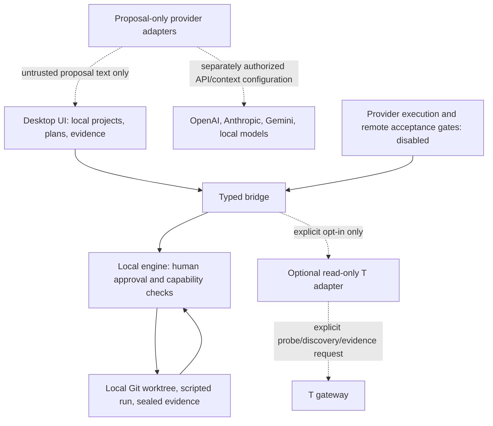

# Standalone core and optional integrations

TAKO-011 makes the normal desktop startup **local standalone**. It needs a local
app-data directory, Git and the platform desktop libraries; it needs no T service,
operator token, gateway URL, provider API key or integration configuration.

## Architecture

The engine has no T SDK, service client or T credential dependency. The optional
network boundary lives in bridge/src/integration.rs and uses the existing public
read-only client/evidence contracts. The engine's approval, capability, isolation,
verification and decision boundaries are unchanged. Offline authenticity tooling
is separate and is not a Desktop runtime dependency or activated Authority.

The provider interface is a separate axis from execution backends; TAKO-012 adds
an explicit OpenAI text adapter without changing this separation. See
[the provider proposal](PROVIDER_ADAPTER_BOUNDARY.md). A connected T adapter does
not configure or authorize an AI provider. A model proposal cannot become an
accepted mission, verified evidence or granted permission.

## Startup and explicit states

Native startup calls Bridge::open, which creates/recover()s only the local engine
and initializes the optional adapter with no client. The UI requests startup_report
and integration_status, both local metadata calls. It does **not** probe a gateway.
There is no mandatory token/config read and no service autodetection or startup wait.

| Mode | Availability | Meaning |
| --- | --- | --- |
| standalone | disabled | No adapter instance; backend requests are refused without network access |
| optional_backend | not_checked | User/embedding host explicitly enabled T; no health result yet |
| optional_backend | available | Last explicit gateway health request was reachable; this is not mission or issuer trust |
| optional_backend | unavailable | Last explicit health request failed; local core remains usable |

Configuration is in-memory and defaults off on each launch. Enabling T is a
separate user action. It may consult the optional existing operator credential
file; missing/invalid credentials do not prevent local operation. The reader is
bounded and requires a regular file rather than waiting on a FIFO. No key is
created, no mandatory environment configuration is added, and no model credential
is read or inferred. Disabling drops the adapter and clears displayed backend
lists/evidence; it does not cancel or alter an active local scripted mission.

Availability describes connectivity, not authentication, operational readiness,
verification, acceptance or confinement. Public health can be reachable while
protected discovery/evidence calls fail authentication. Those requests still fail
closed. No cached discovery result is substituted for a failed request.

## Local and backend projects are different commands

open_project is always a local filesystem/Git operation, for absolute or relative
paths. Invalid/unavailable local paths retain the engine's error; they do not
fall through to a private service or turn an unknown name into a successful project.
This also permits offline inspection of local paths that previously triggered
backend discovery heuristics.

open_backend_project is an explicit optional-adapter request by project ID. It
returns backend-reported project metadata and unverified goal summaries without
opening that reported path on the local filesystem. The response carries source
`t_backend`; local project views carry source `local`. The UI chooses read-only
backend controls from this origin, not path substrings or registry coincidence.
Backend registry data cannot grant or revoke local filesystem/shell permissions.

Conservative legacy stabilization mutation guards for reserved backend path/ID
patterns are retained in every mode, including a canonical-path check against
symlink aliases. They are restrictions, not discovery or authorization. They can
still reject legitimate local names matching those reserved patterns; replacing
that coarse policy needs a separate reviewed migration. Such paths can be opened
for local inspection without contacting T.

## Availability and concurrency

All local commands use the engine directly. Optional network requests clone their
adapter configuration and release locks before I/O. A generation check rejects
results if the user changed/disabled the integration while a request was in flight.
No optional credential/config I/O holds the integration lock needed by metadata calls.

The UI has independent optional-integration pending/error state. Slow health,
backend project or remote evidence reads cannot disable local project selection,
mission planning or local evidence inspection. Selection generations discard old
remote results after local navigation. Disabling also fences late status responses
so they cannot restore stale backend lists. A startup metadata reply cannot overwrite
an explicit user configuration action.

Already-started read-only HTTP work may finish within existing client timeouts;
disabling invalidates its results rather than claiming network cancellation. The
native shell dispatches separate calls on blocking workers. The stdio harness is a
development test transport with a serial input loop; actual concurrent network/local
behavior is qualified directly against the multithreaded Rust Bridge in tests.

## Security invariants

- Local scripts still need human approval of the exact plan and explicitly granted
  capabilities. No checkbox is preselected, no integration setting grants access,
  and local shell/filesystem behavior remains the engine's existing L0 policy.
- L0 is a Git worktree, not a security sandbox. Standalone is not an air-gap or a
  restriction on the behavior of a human-authored, explicitly approved local script.
- Provider execution is refused in the bridge and engine. No provider binary is
  selected by a vendor-specific bridge fallback, and no model API is called.
- Unknown backend IDs, outages, missing/corrupt evidence and unauthenticated exports
  never become local mission success. The production Authority remains NoAuthority.
- Backend metadata/availability cannot enable remote acceptance or L1 badges. The
  TAKO-007E production trust decision remains BLOCKED with its known rollback gates.
- The native capability manifest is unchanged: only the folder-picker permission;
  no frontend shell, filesystem or HTTP permission was added.

## Migration and next slices

| Previous behavior / consumer | Migration |
| --- | --- |
| Bridge::open creates a T client implicitly | Default is standalone; explicit configure_integration enables the optional client |
| UI automatically calls backend_status at mount | Startup uses integration_status only; health is an explicit enable/refresh action |
| open_project may treat path/name as backend lookup | Use open_project for local paths and open_backend_project for registered backend IDs |
| Registry/path text determines backend UI mode | Use explicit ProjectView.source / backend_project_id |
| Existing backend_* commands | Retained behind explicit enablement; disabled requests return integration_disabled (status returns a disabled DTO) |
| Default stdio test harness | Standalone; explicit test port uses a fixture adapter; `t` explicitly enables the legacy operator-configured gateway |
| Live integration tests | Remain opt-in; migrate project lookup to open_backend_project |

Commands added: integration_status, configure_integration {enabled}, and
open_backend_project {project_id}. Backend health/discovery/evidence contracts remain
read-only and fail closed; existing explicit open_with_client embedding/test callers
still opt in deliberately. No private adapter repository change is required.

TAKO-012 implements one explicitly configured proposal-only OpenAI adapter; see
[configuration](PROVIDER_CONFIGURATION.md). TAKO-013 adds explicit
[project context and scoped session history](PROJECT_AI_CONTEXT.md) above this
text-only adapter interface. Tools and execution remain disabled; qualification
uses offline HTTP fixtures. Optional config
persistence, endpoint/credential UX, native-window qualification and replacement of
legacy path protections are separate future slices. Any remote evidence Authority
still requires the independent production trust prerequisites from TAKO-007E.
