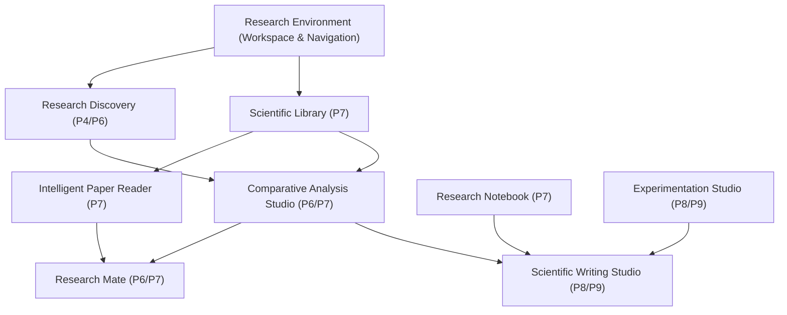

# TAKO Product Capability Map

> **Boundary Note:** Only CLI SOTA discovery, offline/local evidence gating, and basic exports are implemented today (`v0.1.0a2`). Desktop studios (`P7+`) and ecosystem integrations (`P9+`) are planned.

| Studio | Core Capabilities | Current (`v0.1.0a2`) | MVP Boundary (`P6`–`P7`) | Future Expansion (`P8+`) |
|---|---|---|---|---|
| **Research Discovery** | Literature search, foundational paper discovery, SOTA Studio, trends, reviews, gap ID | CLI multi-source search (`openalex`, `arxiv`, `crossref`, `semantic-scholar`) | Foundational anchor ranking (`M029C`), SOTA Studio UI (`M029G`) | Automated trend tracking |
| **Scientific Library** | Publication management, PDF ingestion, metadata, collections, tags, dedup, bib verification | Dedup + bib verification (`.txt`/`.md`/`.bib`/`.ris`/JATS) | Local library view, collections, controlled PDF text extraction (`M029G`) | Full-text indexing & citation graph |
| **Intelligent Paper Reader** | Native reader, passage Q&A, equation/figure/method help, translation, page/passage locators | `NOT_IMPLEMENTED` | Native reader + Research Mate passage Q&A (`M029G`–`M029H`) | Equation/figure multimodal analysis |
| **Comparative Analysis Studio** | Multi-paper comparison, architectures/limitations, datasets, latency/accuracy/HW, comparability, missing metrics | CLI `comparability_assessments.json` | Structured side-by-side comparison matrix (`M029H`) | Automated benchmark table synthesis |
| **Research Mate** | Persistent context, Ask My Library, guided tasks, reasoning, human approval, explicit abstention | CLI `sota-ai` (`fixture`, gated `claude`/`copilot`) | CLI-first (`agy`, `codex`, `claude`, `copilot`) + Research Mate panel (`M029A`, `M029H`) | Proactive hypothesis & review partner |
| **Research Notebook** | Scientific notes, questions, hypotheses, decisions, observations, experiment records | `tako_workspace.json` metadata | Structured Markdown/JSON research notebook (`M029I`) | Linked knowledge graph |
| **Scientific Writing Studio** | Outlines, evidence-grounded drafts, citations, MD/BibTeX/LaTeX export, manuscript review, Overleaf | CLI `references.bib`, `sota_report.md` | Draft export with verified citation grounding (`M029I`+) | Overleaf sync & manuscript reviewer |
| **Experimentation Studio** | Jupyter integration, code, datasets, experiment tracking, metrics, reproducibility, Git/GitHub | `NOT_IMPLEMENTED` | Workspace links to code/metrics (`M030` JetSeg) | Native `.ipynb` & run tracking |
