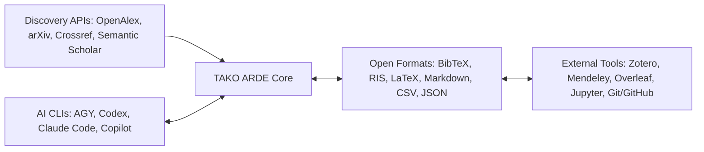

# TAKO Research Ecosystem Strategy

TAKO prioritizes open formats and local file interoperability before complex third-party synchronization.

| Integration | Existing (`v0.1.0a2`) | Proposed Import/Export | Planned Native Integration | Unverified / External Caveats |
|---|---|---|---|---|
| **Discovery Providers** | `openalex`, `arxiv`, `crossref`, `semantic-scholar`, `google-scholar-assisted` | Additional open metadata feeds | Configurable provider registry (`M029C`) | Semantic Scholar anonymous rate limits |
| **AI CLI Providers** | `claude-cli`, `copilot-cli` (API-gated), `agy` (CLI operator) | Unified config profile selection | CLI-first subscription mode for `agy`, `codex`, `claude`, `copilot` (`M029A`) | External CLI sessions have vendor quotas |
| **LaTeX & BibTeX / RIS** | `references.bib`, `references_candidates.bib`, `references.ris` export | `.bib` / `.ris` library import | Two-way citation sync (`P8`–`P9`) | — |
| **Zotero** | `DOCUMENTED_ONLY` | `.bib` / `.ris` / CSL-JSON exchange | Local Zotero DB / API connector (`P9`) | Auth/API rate limits unverified |
| **Mendeley** | `DOCUMENTED_ONLY` | `.bib` / `.ris` export/import | Optional Mendeley API (`P9`) | OAuth app & TOS unverified |
| **Overleaf** | `NOT_IMPLEMENTED` | Export `.tex` + `references.bib` | Git-bridge / Overleaf sync (`P9`) | Overleaf Git bridge requires paid plan |
| **Jupyter** | `NOT_IMPLEMENTED` | Link `.ipynb` outputs & metrics | Experimentation Studio (`P8`–`P9`) | — |
| **Git & GitHub** | Standard Git workspace compatibility | Workspace version tracking | Integrated commit/handoff UI (`P7`–`P9`) | Never push without human approval |
