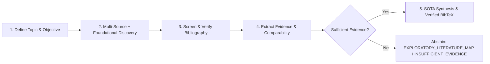

# TAKO Research Workflows

TAKO organizes the researcher experience around scientific tasks rather than technical CLI flags. **Create a State of the Art** is the first end-to-end workflow.

| Workflow | Inputs | Steps | Outputs | Evidence Requirements | Human Decision Points | Failure / Abstention Conditions |
|---|---|---|---|---|---|---|
| **1. Create a State of the Art** *(1st E2E)* | Topic, objective, sources, HTTP budget | Plan -> Search + foundational anchors -> Bib verify -> Screen -> Extract -> Synthesize | `sota_report.md`, `literature_matrix.csv`, `references.bib`, `research_gaps.json` | Verified DOIs separated from candidates; claims linked to locators | Approve scope, inclusion/exclusion, final synthesis | `INSUFFICIENT_EVIDENCE` if full-text/claim support missing |
| **2. Quick Literature Review** | Topic/question, time/paper cap | Targeted search -> Dedup -> Abstract summary | Exploratory map + candidate BibTeX | Clearly labeled `ABSTRACT_ONLY` | Select papers for deep reading | Abstain from comparative claims |
| **3. Understand a Paper** | Local paper (`.md`/`.txt`/PDF*) | Load text -> Structure sections -> Guided Q&A | Annotated notes + passage locators | Exact page/passage locator | Confirm interpretation | Refuse unsupported extrapolation |
| **4. Compare Papers** | >=2 library papers, criteria | Align metrics/datasets -> Flag missing/incompatible units -> Matrix | Comparison table + comparability report | Explicit unit/protocol comparability | Approve comparability assumptions | `INCOMPARABLE` when protocols diverge |
| **5. Ask My Library** | Question, workspace library | Retrieve grounded passages -> Synthesize with citations | Cited answer + uncertainty notes | Passage-level provenance | Verify cited passages | Abstain when library lacks evidence |
| **6. Find Research Gaps** | SOTA matrix / claims | Cluster limitations -> Detect missing evaluations | `research_gaps.json` | Traceable to paper limitations | Prioritize gaps for pilot | Mark gaps as `HYPOTHESIS` if abstract-only |
| **7. Develop Research Questions** | Gaps, domain constraints | Formulate testable questions -> Link to gaps | Versioned questions in Notebook | Linked gap IDs | Select primary research question | Flag underspecified scope |
| **8. Build a Hypothesis** | Research question, baselines | State falsifiable claim + expected mechanism | Hypothesis record | Prior baseline evidence | Approve hypothesis & falsification criteria | Reject unfalsifiable statements |
| **9. Plan an Experiment** | Hypothesis, dataset/hardware | Define metrics, baselines, ablations | Experiment plan | Reproducible protocol | Approve resource/compute budget | Block if baseline metrics undefined |
| **10. Review My Manuscript** | Draft (`.md`/`.tex`), library | Check citation grounding -> Flag unsupported claims | Review checklist | Verified BibTeX + passage match | Resolve flagged claims | Flag `UNVERIFIED_CITATION` |
| **11. Prepare References** | Accepted/candidate papers | Verify DOIs -> Format `.bib` / `.ris` / LaTeX | `references.bib`, `references.ris` | Strict verified vs candidate split | Approve candidate promotion | Quarantine unresolved DOIs |
